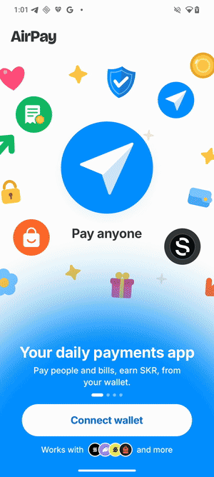
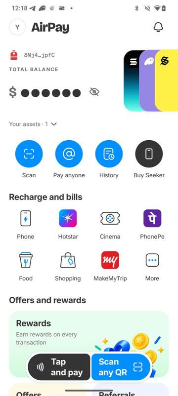
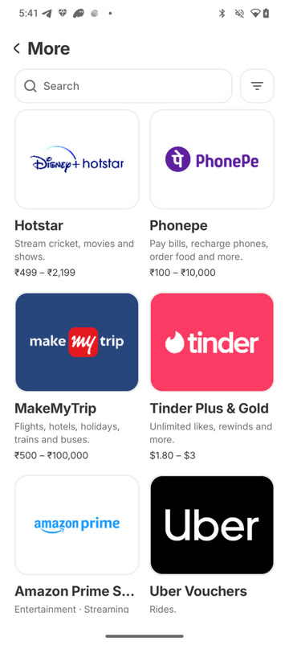
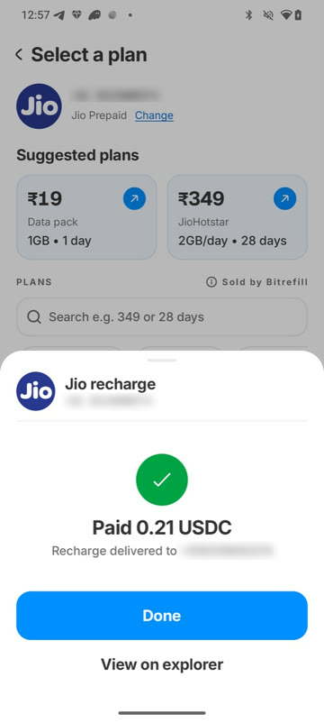
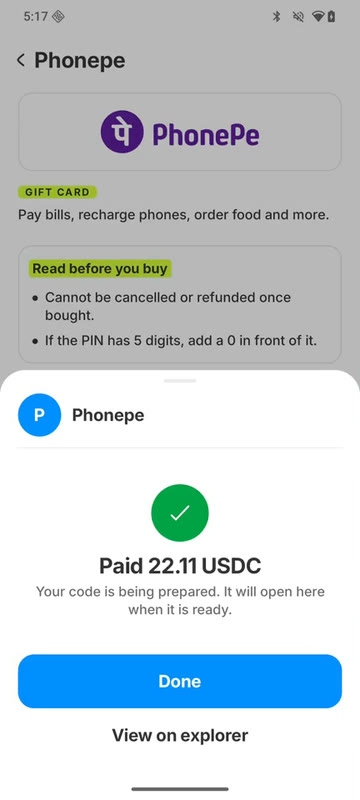
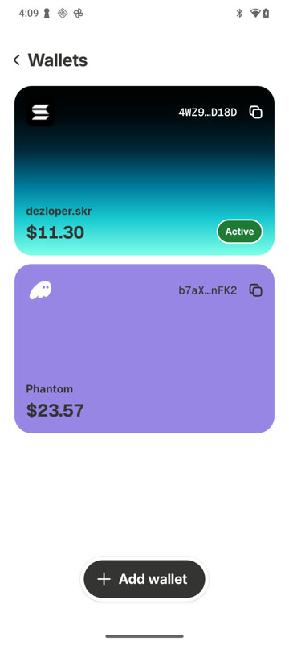
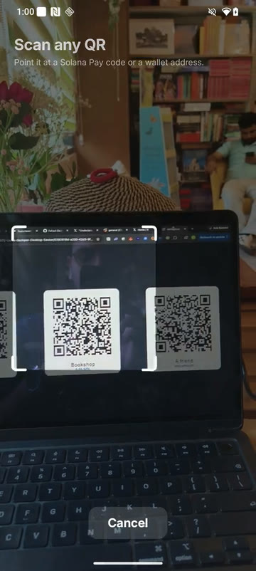
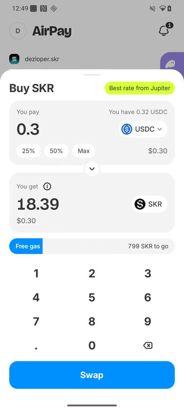
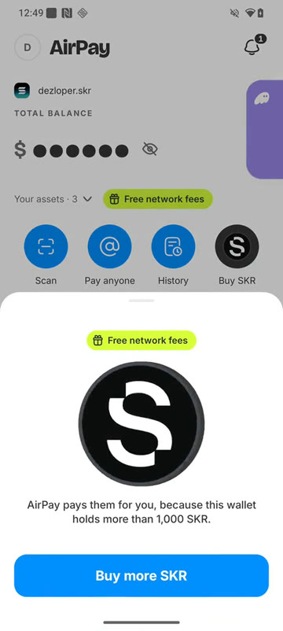

<p align="center">
  
</p>

<p align="center">
  <b>Pay your bills with crypto.</b><br>
  Recharge a phone, pay a bill, buy a gift card or pay a friend, in USDC or SOL, straight from the wallet you already have.
</p>

<p align="center">
  
  
  
  
</p>

<p align="center">
  
</p>

AirPay is a native Android payments app for the Solana Seeker. It doesn't hold your money or your
keys: it links the wallets you already use and gives you things to do with what's in them. Every
payment is signed in your own wallet and confirmed on Solana mainnet.

Built for **Clock In**, the Solana Mobile hackathon.

> The Android package is `so.duffle.app` and some folders say `duffle`. That was the app's earlier
> name. It's the same app.

---

## Screens

<table>
  <tr>
    <td align="center"><br><sub><b>Home</b></sub></td>
    <td align="center"><br><sub><b>150+ services</b></sub></td>
    <td align="center"><br><sub><b>Recharge paid</b></sub></td>
    <td align="center"><br><sub><b>Bill paid in USDC</b></sub></td>
  </tr>
  <tr>
    <td align="center"><br><sub><b>All your wallets</b></sub></td>
    <td align="center"><br><sub><b>Scan any QR</b></sub></td>
    <td align="center"><br><sub><b>Buy SKR</b></sub></td>
    <td align="center"><br><sub><b>Free network fees</b></sub></td>
  </tr>
</table>

## What it does

| | |
|---|---|
| 🧾 **Bills and recharges** | Phone recharges, bills and gift cards for 150+ services, paid in USDC or SOL. Sold and delivered by Bitrefill. |
| 👛 **Every wallet in one place** | Link Seeker Wallet, Phantom, Solflare and Backpack through Mobile Wallet Adapter, and switch in one tap. |
| 🔎 **Pay anyone** | Type a `.skr`, `.sol` or `.air` name, or scan a Solana Pay QR code. |
| 📲 **Tap to pay** | Hold two phones together: one acts as a card over NFC, the other reads it and the pay sheet opens. |
| ⛽ **No SOL needed** | AirPay's fee wallet pays the network fee. Wallets holding 1,000+ SKR pay nothing at all. |
| 🪙 **Earn and buy SKR** | Verified Seeker owners earn SKR as scratch cards. Swap any token for SKR at the best Jupiter rate. |

## How it fits together

```
┌────────────────────┐   signs    ┌───────────────────────┐
│  Android app       │──────────► │  The user's wallet    │
│  app/              │   (MWA)    │  (Seeker, Phantom, …) │
└─────────┬──────────┘            └───────────────────────┘
          │ HTTPS
          ▼
┌────────────────────┐   asks     ┌───────────────────────┐
│  AirPay server     │──────────► │  Payer                │
│  server/           │   (HMAC)   │  payer/               │
│  watches the chain,│            │  the only part that   │
│  shop, rewards,    │            │  holds a key: pays    │
│  push              │            │  rewards, sponsors    │
└────────────────────┘            │  network fees         │
                                  └───────────────────────┘
```

| Folder | What it is |
|---|---|
| [`app/`](app) | The Android app. Kotlin and Jetpack Compose, one module. |
| [`server/`](server) | The backend. Python and SQLite, in Docker. Every "paid" is checked against a transaction it fetched from Solana itself. |
| [`payer/`](payer) | A small separate service that holds the two keys (SKR rewards and network fees). The server can only ask it; it checks, caps and signs. |

---

## Get it running

### The fast way: let an AI assistant set it up

[`AGENTS.md`](AGENTS.md) is written for AI coding assistants (Claude Code, Cursor, Codex and
others). It tells the assistant where everything is, what it may do on its own, and what it must
ask you for. Open the repository in your assistant and paste:

```text
Read AGENTS.md and set this project up for me. Check what's already installed and configured,
ask me only for what's missing, start the server, then build the app and install it on my
connected phone. Don't press Pay or approve anything in a wallet; tell me when it's my turn.
```

The assistant will stop and ask before it touches anything that costs money or deletes data.

### The manual way

<details>
<summary><b>1. What you need</b></summary>

- macOS or Linux, **JDK 17**, the **Android SDK** (API 36) and `adb`
- **Docker**, for the server
- **Python 3.10+**, only to run the server's tests outside Docker
- An Android phone with NFC, Android 12 or newer, with a Solana wallet app installed
- Optional: `cloudflared`, to reach the server from outside your Wi-Fi

</details>

<details>
<summary><b>2. Keys and accounts (all optional, each switches a feature on)</b></summary>

None of these are in the repository. The app builds without them.

| What | Where it goes | What it switches on |
|---|---|---|
| Firebase project (Android app `so.duffle.app`) | `firebase.*` in `local.properties`, and the service-account JSON named by `FCM_KEY_FILE` in `server/.env` | Push notifications. **The server won't start in Docker without `FCM_KEY_FILE`.** |
| Bitrefill API key | `BITREFILL_API_KEY` in `.env` | Recharges, bills and gift cards |
| Solana RPC URL (Helius or Alchemy) | `DUFFLE_MAINNET_RPC` in `.env` | Reliable chain reads. The public RPC works but is rate limited. |
| SKR reward wallet keypair | `secrets/payer.json`, its public key as `PAYER_PUBKEY` in `server/.env` | Paying SKR rewards. Needs SKR and a little SOL. |
| Fee wallet keypair | `secrets/sponsor.json`, its public key as `SPONSOR_PUBKEY` in `server/.env` | Free network fees. Needs a little SOL (0.05 is plenty). |
| Pyth API key | `pyth.apiKey` in `local.properties` | Live token prices on Home |

`secrets/`, `.env` and `local.properties` are gitignored. Never commit them.

</details>

<details>
<summary><b>3. <code>local.properties</code> (repository root)</b></summary>

```properties
sdk.dir=/path/to/Android/sdk
# Where the app finds the server: your computer's Wi-Fi address, or a public https address
duffle.server=http://192.168.1.50:8787
rewards.enabled=true
# Optional
firebase.appId=
firebase.apiKey=
firebase.projectId=
firebase.senderId=
pyth.apiKey=
```

</details>

<details>
<summary><b>4. Start the server</b></summary>

```bash
./run.sh            # build and start the server, wait until healthy, seed the offers
./run.sh payer      # the same, plus the payer (needs the keys from step 2)
./run.sh status     # health and containers
./run.sh logs       # follow the logs
./run.sh stop       # stop everything; data is kept
```

</details>

<details>
<summary><b>5. Build and install the app</b></summary>

```bash
./gradlew :app:assembleBenchmark
adb install -r app/build/outputs/apk/benchmark/app-benchmark.apk
```

| Build | Use it for |
|---|---|
| `debug` | Development. Allows plain `http://` to a server on your Wi-Fi. |
| `benchmark` | Testing on a real phone: release speed, debug signing, preview hooks on. |
| `share` | A build to give someone else. Points at a public address, signed with your own key. |

</details>

<details>
<summary><b>6. One command for everything</b></summary>

```bash
./start.sh          # server + public tunnel + fresh APK on every connected phone
./start.sh stop
./fresh.sh          # start over as a new user: wipes the server database and the app's data
./share.sh          # server + public tunnel + a signed APK in dist/ to send to someone
```

The free tunnel gets a **new address every time it restarts**, and the app is built knowing the
server's address. If the app can't load anything, the address changed: run `./start.sh` again.

</details>

### Tests

```bash
./gradlew :app:testDebugUnitTest      # app
./run.sh test                         # server and payer
```

---

## Good to know

- **It moves real money.** The app is on mainnet. Test with small amounts.
- **A wallet that just switched or disconnected has to authorize again.** Open Rewards and approve
  once in the wallet.
- **Free network fees need the fee wallet funded.** With no SOL in it, nothing is sponsored.
- **Not a wallet.** AirPay holds no keys and can't move anyone's funds.
- **Not tap-to-pay at a shop terminal.** That needs card-network keys; AirPay's tap is phone to
  phone.
- **Not on iPhone.** Apple restricts NFC card emulation to licensed payment providers.

## More docs

- [AGENTS.md](AGENTS.md): a map of the code for AI assistants and new contributors
- [server/README.md](server/README.md): how the server finds and verifies a payment
- [payer/README.md](payer/README.md): the payer, its limits and how to pause it
- [TESTING.md](TESTING.md): testing on real phones
